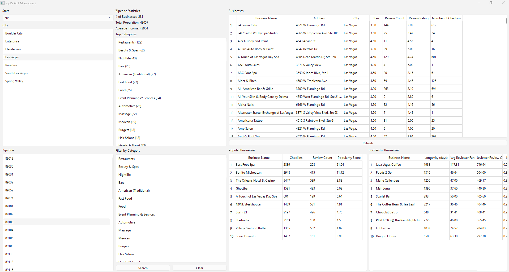
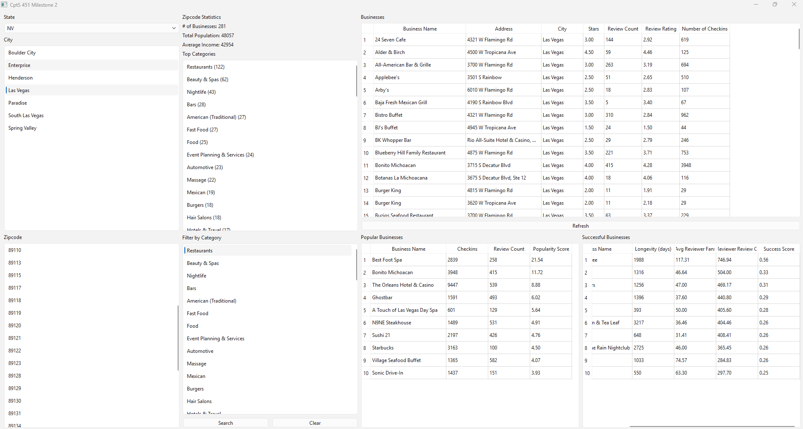
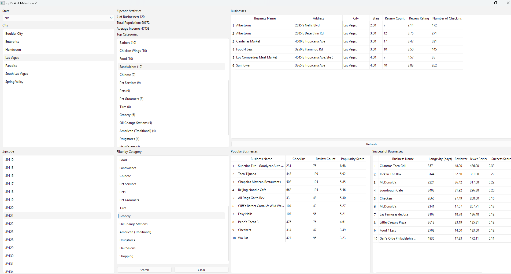

# Yelp Business Analytics

A desktop app for exploring Yelp business data by location and category, backed by a PostgreSQL database I designed and loaded from raw Yelp JSON. Built for CptS 451 (Database Systems) at Washington State University.

Pick a state, city, and zipcode and the app shows census statistics for that area, the categories present there, and a searchable business table. A Refresh button ranks the zipcode's businesses by two custom metrics I defined, "popular" and "successful."

<!-- SCREENSHOT: full GUI with a zipcode selected (stats panel, categories, results table) -->



## Features

- **Cascading location filters:** state, city, and zipcode lists, each repopulated by a live query. Changing an upstream selection clears everything downstream so stale results never sit beside a new selection.
- **Zipcode statistics:** number of businesses, population, and average income (census data joined by zipcode), filled in automatically when a zipcode is selected.
- **Category browsing:** top categories for the zipcode with business counts, plus an optional category filter applied through Search and Clear buttons.
- **Popular and Successful panels:** top 10 businesses in the selected zipcode under each metric, with the score shown.

<!-- SCREENSHOT: category filter applied, results narrowed -->



<!-- SCREENSHOT: Popular / Successful panels after clicking Refresh -->



## Tech stack

Python, SQL, PostgreSQL, PyQt6, psycopg2

## Database design

The schema has 8 tables, designed from an ER diagram with cardinality and participation constraints (see `docs/`).

| Table                | Role                                                                                |
| -------------------- | ----------------------------------------------------------------------------------- |
| `business`           | Core entity. Includes `num_checkins` and `reviewrating`, computed after load.       |
| `zipcodedata`        | Census population and average income per zipcode. Referenced by `business.zipcode`. |
| `category`           | One row per distinct category name.                                                 |
| `business_category`  | Many-to-many junction between businesses and categories.                            |
| `business_attribute` | Weak entity, identified by its business.                                            |
| `checkin`            | Weak entity, identified by business, day, and hour.                                 |
| `yelp_user`          | Reviewer profiles.                                                                  |
| `review`             | Each review belongs to exactly one business and one user.                           |

Design decisions worth noting:

- Participation constraints from the ER diagram are enforced with `NOT NULL` and foreign keys (for example, every review requires a business and a user).
- Weak entities use `ON DELETE CASCADE` so removing a business removes its check-ins and attributes.
- The friends network in the raw data is deliberately not modeled, since no feature uses it.
- Zipcode income uses the census median rather than the mean. The mean was consistently higher, which indicates skew from high earners, so the median better represents a typical resident.

## Data pipeline

`parseJSON.py` reads the four Yelp JSON files and writes PostgreSQL `INSERT` statements, one file per table, in foreign-key-safe order. The final run generated about 1.36 million rows:

| Table              | Rows    |
| ------------------ | ------- |
| business           | 11,481  |
| category           | 226     |
| business_category  | 33,619  |
| business_attribute | 227,536 |
| checkin            | 481,360 |
| yelp_user          | 192,999 |
| review             | 416,479 |

Before loading anything, I validated the generated files: row counts against the source JSON, every row checked against its expected structure and quote escaping, foreign-key references checked against their parent files, and `VARCHAR` limits checked. This caught a real problem: the first run happened under Windows Python, which produced files in mixed encodings (cp1252 and UTF-8) with CRLF line endings and stray carriage returns inside review text. I fixed the parser to strip carriage returns and regenerated everything as clean UTF-8, then loaded it in a single transaction.

After the load, `update_stats.sql` recomputes each business's check-in total, review count, and average review rating. It aggregates into temporary tables once and updates through a join, instead of running a correlated subquery per business.

## Popular and successful metrics

Both metrics compare a business to its peers instead of using raw counts, since raw counts just reward large chains and busy zip codes. The full write-up is in `docs/`.

**Popularity.** For every (zipcode, category) pair I precompute average check-ins and average review count. A business's expected values are the average of those across all categories it belongs to. Its score is how far its actual check-ins and reviews exceed expectation, as a proportion of expectation, summed over both signals.

**Success.** Longevity is the span between a business's first and last review (the data has no founding date). Loyalty is approximated by the average fan count and review count of the people who reviewed it. The three components are min-max normalized and summed. Only businesses with at least 10 reviews are scored: without that minimum, outlet stores with two or three reviews from very active users dominated the top of the list.

Two consequences worth knowing: a business with fewer than 10 reviews can appear in the Popular panel but not the Successful one, and a business whose peer group averages zero check-ins gets no popularity score.

## Repository layout

```
.
├── yelp_business_explorer.py   # PyQt6 GUI
├── parseJSON.py                # JSON -> INSERT statement generator
├── schema.sql                  # CREATE TABLE statements
├── update_stats.sql            # numCheckins / review_count / reviewrating
├── analysis_queries.sql        # tables and queries behind the two metrics
└── docs/                       # ER diagram, metrics paper, screenshots
```

## Data

The dataset is **not included** in this repository. The project used a smaller subset of the Yelp Academic Dataset prepared by my instructor, which is not publicly redistributable, and Yelp's terms restrict redistributing their data. To reproduce the project, download the Yelp dataset from <https://www.yelp.com/dataset>. The parser was written against the course subset's JSON format, so it may need adjustments for the full release.

The zipcode population and income table came from US Census data supplied with the course. Public Census sources are available at <https://www.census.gov/data.html>.

## Running it

Requires Python 3, PostgreSQL, and `pip install psycopg2-binary PyQt6`.

1. Create a database named `yelpdb` and run `schema.sql`.
2. Load your zipcode data into `zipcodedata(zipcode, population, avg_income)`.
3. Place the Yelp JSON files next to `parseJSON.py` and run `python parseJSON.py` (pass a number, such as `python parseJSON.py 50`, to process only the first 50 lines of each file as a test run).
4. Load the generated `*_insert.sql` files in this order: category, business, business_category, business_attribute, checkin, yelp_user, review.
5. Run `update_stats.sql`, then `analysis_queries.sql` to build the metric tables.
6. Run the app with `python yelp_business_explorer.py`.

The app connects as user `postgres` on localhost and expects the password to come from a `pgpass.conf` (Windows) or `~/.pgpass` file, so no credentials live in the code.

## Documentation

- ER diagram: `docs/`
- Metrics write-up: `docs/`
